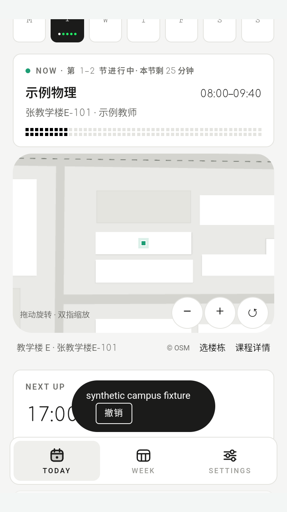
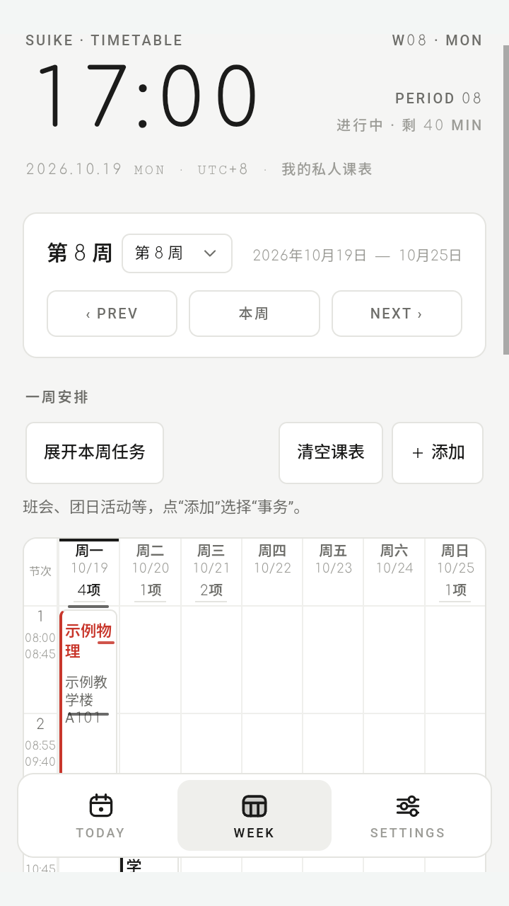
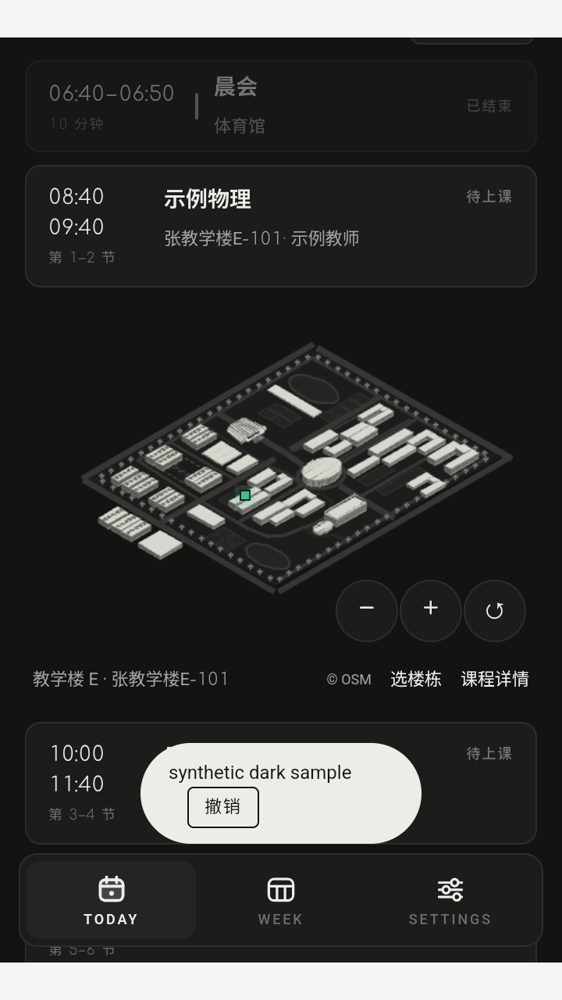

# 随课 · Suike

离线课表，把课程、临时事务和下一节课的建筑位置放在一起。

[](docs/BUILD.md)
[](LICENSE)
[](https://github.com/lawrencehaohan-coder/suike/releases/tag/v1.6.0-beta.28)
[](harmony)

**[下载安卓安装包](https://github.com/lawrencehaohan-coder/suike/releases/download/v1.6.0-beta.28/suike-1.6.0-beta.28-android.apk)** · [版本说明](https://github.com/lawrencehaohan-coder/suike/releases/tag/v1.6.0-beta.28) · [反馈问题](https://github.com/lawrencehaohan-coder/suike/issues) · [构建说明](docs/BUILD.md)

<p>
  
  
  
</p>

截图使用示例课程。当前版本：Android **beta28**，HarmonyOS **alpha20**。

## 功能

- **Today / Week**：当天安排、下一节课、整周课表，显示上课进度与本学期剩余课时。
- **临时事务**：班会、团日活动等按实际起止时间添加。周表默认收起为细横线，展开后与课程一起显示；支持冲突提示、调课、撤销。
- **教务导入**：江苏科技大学校园 VPN 优先，读取课表后核对导入。节次时间在 Settings 统一设置，同步到 Today、Week 和提醒。
- **DeepSeek 导入**：使用自己的 API Key，识别通知文字、Excel、Word、PDF 和图片；信息不足时补充确认，再预览写入。
- **建筑位置示意图**：江苏科技大学张家港校区课表可查看教室所在建筑，支持镜头定位、旋转缩放和课程状态灯。位置、外形与高度为近似示意。
- **黑白与像素**：浅色、深色、跟随系统，液态玻璃与磨砂调节，也可使用图片或视频壁纸。普通主题搭配分时像素场景。
- **设备功能**：Android 桌面小组件、本地备份与课程提醒；鸿蒙提供原生桥接和服务卡片，仍在开发。

课程和修改保存在当前设备。教务登录与可选的 AI 识别需要联网；使用 AI 时，消息和文件内容会提交到自己配置的服务。详见 [数据说明](docs/PRIVACY.md)。

## 快速预览

安装 Python 3，在项目根目录运行：

```sh
python android/preview.py
```

也可打开 `android/打开预览.html`。浏览器用于查看界面；系统提醒、小组件、教务网页登录需在应用中体验。

## 开发

| 目录 | 内容 |
| --- | --- |
| `android/` | Android 外壳、共享前端、教务解析与测试 |
| `harmony/` | ArkTS 原生桥接、服务卡片与鸿蒙工程 |
| `scripts/` | 自动化测试与发布检查 |
| `docs/` | 构建说明、数据说明与界面截图 |

前端与模型测试需要 Node.js 22 或更新版本：

```sh
npm ci
npm test
python scripts/audit-public.py
```

Android 构建见 [docs/BUILD.md](docs/BUILD.md)，HarmonyOS 见 [鸿蒙构建说明](harmony/README_构建.md)。SDK 和发布签名需自行配置；鸿蒙安装前需要签名与设备授权。

## 参与

觉得好用，欢迎点个 **Star** 收藏。有想法或遇到问题，可以提 [Issue](https://github.com/lawrencehaohan-coder/suike/issues)，也欢迎提交 PR；开发约定见 [CONTRIBUTING.md](CONTRIBUTING.md)。

## 许可证

原创代码采用 [MIT](LICENSE)。第三方代码、字体、OCR、像素场景与校园几何数据保留各自许可，校园几何适用 ODbL，详见 [第三方说明](THIRD_PARTY_NOTICES.md)。
